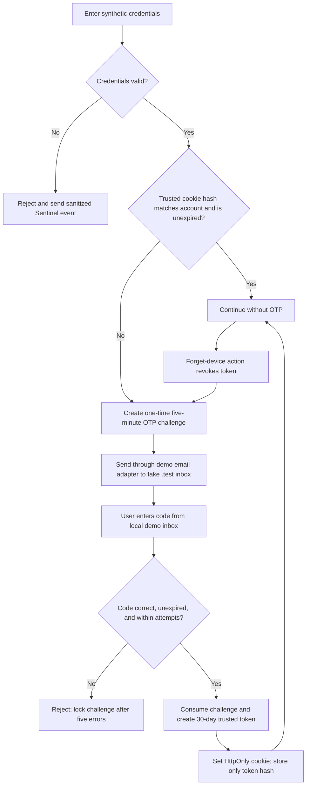

# Campus Hub + Sentinel

An original, fictional campus portal connected to Sentinel's defensive event monitor.
It is a standalone demo, not a Contineo clone and not connected to Contineo.

## Start the demo

1. Copy `.env.example` to `.env`.
2. Replace `SALT` and `SENTINEL_ADMIN_TOKEN` with separate random demo secrets.
3. Optional: add Gemini and Telegram credentials.
4. Run `docker compose up --build`.
5. Open `http://localhost:8000` for Campus Hub and `http://localhost:8501` for the Sentinel dashboard.

To see a Sentinel alert, open the Results portal, enter `DEMO0001`, and submit an incorrect date of birth three times. Refresh the dashboard; the alert explains that the same synthetic account had three failed sign-ins.

To try two-factor sign-in, use the valid demo credentials (`DEMO0001`, DOB `2005-01-01`, Results campus ID `DEMO-ID-0001`). A new browser must enter a one-time code. The displayed `.test` email is fictional; open the local demo inbox link to read its code. After verifying, that browser skips OTP for 30 days. Use **Forget this trusted device** to revoke it and try again.

The demo uses fake accounts only. Never point it at Contineo or real student data.

## Services

| Service | Access | Purpose |
|---|---:|---|
| Campus Hub gateway | `localhost:8000` | Original portal selection page and protected routing |
| Results portal | Internal | Synthetic account, DOB, and campus ID sign-in |
| Library portal | Internal | Synthetic account and DOB sign-in |
| Sentinel API | `localhost:9000` | Risk scoring and alert API |
| Dashboard | `localhost:8501` | Review explainable alerts |

Open the fictional portals through the proxy at `http://localhost:8000/results/`
and `http://localhost:8000/library/`. Results validates a synthetic USN and DOB,
redirects to a separate demo ID-card step, then opens a sample student dashboard.
The library portal uses synthetic USN and DOB. Neither page uses real institution
branding or accepts real student credentials.

Test accounts use `DEMO0001` through `DEMO0020`.
Their DOB is `2005-01-01`.
Results ID numbers use `DEMO-ID-0001` through `DEMO-ID-0020`.
Their fictional email addresses are `demo0001@students.campus.test` through `demo0020@students.campus.test`; `.test` addresses cannot receive real email.
The `/directory` pages show synthetic Faker names. Results and Library are reachable through the gateway so sign-in events pass through the Sentinel-connected proxy.

## Two-factor and trusted-device demo

The portal checks a trusted-device cookie only after the synthetic primary credentials are valid. A new device receives a six-digit, five-minute OTP challenge. The local demo outbox keeps the code in process memory for the demo only; the database stores only a keyed code hash, a one-time challenge-token hash, and attempt metadata. Five wrong OTP entries lock that challenge, and a synthetic account can request at most three codes per hour.

After correct OTP verification, the app places a random opaque token in an `HttpOnly`, `SameSite=Lax` cookie and stores only its SHA-256 hash with a 30-day server-side expiry. The server verifies both token and account; a client-supplied device name/ID is not trusted. HTTPS requests get a `Secure` cookie. The success page lets the user revoke this browser's trusted token.



**Demo-only boundary:** `CAMPUS_EMAIL_PROVIDER=demo` selects an in-memory fake inbox. It does not send email, and the inbox deliberately displays OTPs; never expose this demo service publicly or use it for real accounts. `apps/email_delivery.py` defines the small sender interface intended for a future provider adapter, but Gmail delivery is not implemented or configured.

To add real email delivery later, an administrator must authorize a Google Cloud project, enable the Gmail API, configure OAuth consent and an OAuth client with the minimum send-email scope, and securely provision/store its refresh credentials for a permitted sender account. Do not send API keys, OAuth client secrets, refresh tokens, or real student addresses in chat or commit them to Git. We have not requested or stored any Gmail credentials, and no real email is sent by this demo.

## Watch modes

- Reverse proxy: `proxy/app.py` routes `/results/` and `/library/`, then sends sanitized sign-in metadata to Sentinel.
- Existing access logs: `python -m adapters.log_reader --file PATH --site results`.
- Sanitized application events: `python -m adapters.log_reader --file PATH --format jsonl`.
- Passive uptime, TLS, and headers: `python -m adapters.outside_checks --url URL`.

The log adapter understands Apache/Nginx combined logs and JSON Lines. JSONL input
uses the Sentinel event format (`ts`, `site`, `ip`, `path`, `method`, `status`,
and optional `user_hash` and `ua`). Send only sanitized metadata: `user_hash`
must already be a salted account hash; unknown fields such as passwords or
account identifiers are rejected rather than forwarded. Put one event per line,
for example:

```json
{"ts":"2026-11-25T18:07:00Z","site":"results","ip":"192.0.2.10","path":"/login","method":"POST","status":401,"user_hash":"<salted-hash>"}
```

Outside checks make GET requests only.

## Decision and privacy model

Rules score events from 0 to 100.
- Three failed `POST /login` attempts for one hashed account at one site and IP in five minutes add 35 points and create an explanatory alert; this rule alone is below the rate-limit threshold.
- When an event creates an alert, `POST /event` returns it in an `alert` field; the dashboard reads saved alerts from `GET /alerts`.
Scores of 50 trigger a 30-second rate limit.
Scores of 70 trigger a 15-minute IP block.
Permanent blocks require dashboard approval.
Approval and unblock actions require the admin token.
Gemini writes explanations only; rules control actions.
Template explanations work without an API key.

Events store metadata and salted USN hashes only.
Passwords, DOB, ID numbers, and page content are not stored.
The proxy forwards login bodies without logging them.
This MFA flow applies only to the fictional Campus Hub demo, not Contineo or another vendor portal.
